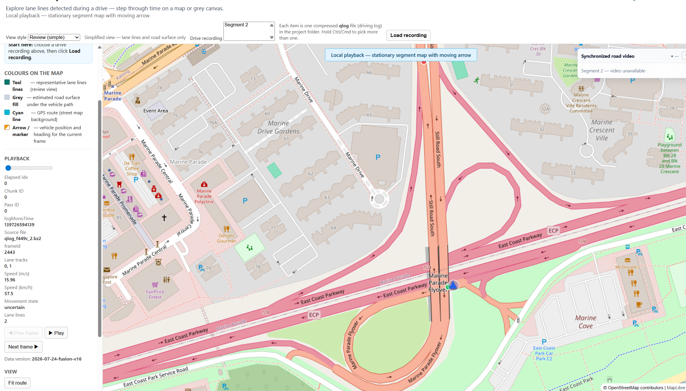

# Road Geometry Viewer

Review lane lines and road shape reconstructed from **vehicle driving logs** (qlog files). Step through a recording on a map or plain canvas, optionally with synchronized dashcam video when matching files are available locally.

**Status:** Frozen supervisor review build — no further feature development is planned in this repository. See [docs/CURRENT_VIEWER_STATUS.md](docs/CURRENT_VIEWER_STATUS.md).



*Screenshot (sample drive segment): **teal** lines are representative lane lines; **cyan** is the GPS path on the street map; the **orange arrow** is the vehicle at the current frame; **grey** shading is the estimated road surface on the plain canvas. This tool shows processed geometry for human review — not verified map data or official lane counts.*

## What is a qlog?

A **qlog** is a compressed driving log (`.bz2`) from a test vehicle. It contains lane detections and GPS fixes produced during a drive. This viewer **does not** download logs from the cloud; you place files on the machine running the server.

## What can you do with it?

- Load one or more drive recordings and play them frame by frame
- See **representative lane lines** and an estimated **road surface** in a simplified **Review** view
- Switch to **Evidence** to overlay observation dots and per-frame source curves
- Show a **street map** or **grey canvas** behind the geometry
- Play **synchronized road video** when a matching `*---qcamera.ts` file is present locally
- Export PNG / CSV / GeoJSON from **Debug** mode (technical users)

## Quick start (three steps)

1. **Install and start** — Node.js 20+, then `npm install` and `npm start` (or `START_VIEWER.bat` on Windows). Open **http://localhost:3847**.
2. **Load data** — Copy your `.bz2` qlog files into the project folder (they are not in Git). Choose a recording in the sidebar and click **Load recording**.
3. **Review** — Use the timeline and **Play** / **Prev frame** / **Next frame**. Use **Fit route** to centre the map. Change **View style** to Evidence if you need underlying observations.

## Requirements

- **Node.js** 20.x LTS (tested with v20.20.x)
- **npm** 10.x
- **Windows:** `START_VIEWER.bat` or `start.bat` from the repository root
- **Any OS:** `npm install` then `npm start` or `node server.js`

Raw qlogs and videos are **not** included in this repository.

## Limitations

- Shows **processed geometry for review**, not certified lane counts or navigation-ready maps
- Geographic representative lane lines may be **missing or incomplete** on the street-map view
- **Satellite** background only works if `MAP_SATELLITE_TILE_URL` is configured ([MAP_SETUP.md](MAP_SETUP.md))
- Some representative lines remain **fragmented** on the grey canvas in difficult segments
- **Debug** and experimental URL flags remain for regression; default use is Review / Evidence only
- Viewer development has **stopped**; this repo documents the frozen supervisor build

## Data and privacy

This repository contains **source code and tests only**. It does not ship raw qlogs, `.bz2` archives, MP4/TS videos, GPS exports, API keys, or private tile tokens.

## Technical documentation

- [docs/TECHNICAL.md](docs/TECHNICAL.md) — architecture, pipeline, URL parameters, tests
- [docs/CURRENT_VIEWER_STATUS.md](docs/CURRENT_VIEWER_STATUS.md) — frozen snapshot details
- [MAP_SETUP.md](MAP_SETUP.md) — optional satellite tiles

## Tests

```bash
npm test
```
